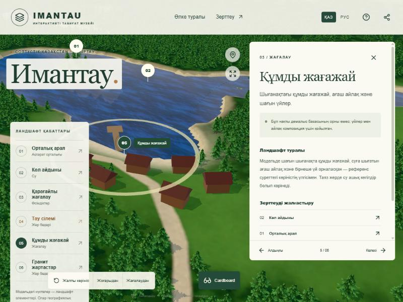
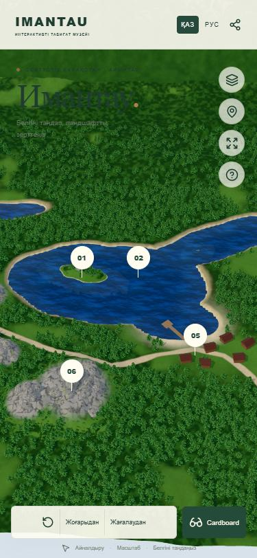

# IMANTAU — интерактивті табиғат музейі

Имантау көліне арналған интерактивті 3D сайт. 3D сахна Blender-де нөлден, берілген референс сурет бойынша жасалды: орманды тау, көк көл, ортасында орманды арал, тығыз қарағай орманы, гранит жартастар, құмды жағажай, айлақ және шағын үйлер. Сайтта зерттеу нүктелері, ақпарат панельдері, қазақша/орысша интерфейс, Cardboard VR режимі және QR арқылы бөлісу бар.


| Жағалаудан | Жағажай және ақпарат панелі | Телефон |
|---|---|---|
|  |  |  |

## Іске қосу

Node.js 20.19+ (немесе 22.12+) және pnpm қажет.

```bash
pnpm install
pnpm dev
```

Production нұсқасы:

```bash
pnpm build
pnpm preview
```

Дайын статикалық сайт `dist/` қалтасында жиналады (`base: './'`, сондықтан GitHub Pages, Netlify, Vercel-ге жариялауға болады). QR-код жария мекенжайға жасалуы үшін build алдында URL көрсетіңіз:

```bash
VITE_PUBLIC_SITE_URL=https://сіздің-домен.kz pnpm build
```

Жергілікті мекенжайға (localhost, IP, http) QR жасалмайды — бұл әдейі жасалған тексеріс.

## 3D сахна қалай жасалды

Бүкіл сахнаны бір скрипт құрастырады — [`tools/blender_build_scene.py`](tools/blender_build_scene.py). Ол Blender 5.2-де фондық режимде ~2 минут жұмыс істейді және әр жолы бірдей нәтиже береді (барлық кездейсоқ сандар тұрақты seed-пен):

```bash
blender -b --factory-startup --python tools/blender_build_scene.py
```

Нәтиже: `public/scenes/IMANTAU-scene.glb` (~12 МБ, WebP текстуралар), `work/blender/IMANTAU-scene.blend`, есеп `work/diagnostics/scene.json`.

### Референстен не алынды

| Референсте | Модельде |
|---|---|
| Артта кең, орманды тау, жотасында сұр жартастар | Үш шыңды процедуралық тау сілемі; жартас тек жоталар мен тік беткейлерде, қалғаны — орман түсі |
| Ортада үлкен көк көл, оң жақта ұзын тармақ | Бірнеше эллипстен құралған көл пішіні, жиегі шуылмен табиғи иілген |
| Көлдің ортасында орманды арал, алыста кішкентай арал | Орталық арал (қарағайлар, тастар) және алыстағы арал |
| Сол жақ артта бөлек шағын көл | Шағын көл |
| Алдыңғы жоспарда гранит төбелер | Жартасты дөңестер + 84 гранит тас |
| Оң жақта құмды жағажай, айлақ, ағаш үйлер, жол | Шығанақтағы кең құмды жағажай, ағаш айлақ, 6 үй, бұралаң жол |
| Тығыз қарағай орманы | 4 435 қарағай + текстурадағы орман түсі |
| Көк аспан, будақ бұлттар, суда шағылысу | Сайттағы процедуралық аспан; су одан шағылыс алады |

### Қадамдар

1. **Жер бедері.** 380 × 440 бірлік аумақ, 116 мың төбе. Биіктік функциясы numpy-да есептеледі: көл ойпаты (SDF) → жағалаудан көтерілетін орманды төбелер (fBm шуыл) → артқы тау сілемі (Гаусс шыңдары + ridged шуыл) → гранит дөңестер → аралдар. Таяз шығанақ жағажай жанында тереңдігі баяу артады.
2. **Жер текстурасы (4096×4096).** Сол функциялардан пиксель сайын түс есептеледі: шалғын, орман асты және жабын (canopy) дақтары, таудағы жартас жоталары, гранит, жол, жағадағы ылғалды құм жолағы, жағажай құмы, су астындағы түп (таяз жерде ақшыл құм → тереңде қою көкшіл).
3. **Қарағай (берілген `pine-tree` ассеті).** `Tree.fbx` импортталады. Ине жапырақ текстурасы зәйтүн-сары түсті болғандықтан, оның жарықтығы сақталып, референстегі қою қарағай жасылына қайта боялды; мөлдірлік картасы альфа-арнаға біріктірілді (alpha clip). Қабыққа берілген түс пен normal map қосылды. Веб үшін ине жапырақ карталары 1 480-нен 738 бетке дейін жеңілдетілді (бір ағаш ≈ 950 үшбұрыш).
4. **Орман.** Ағаштар бетке торап бойынша қойылады: шуыл маскасы алаңқайлар қалдырады, биік/тік жерде, жартаста, жолда, жағажайда және су жиегінде ағаш жоқ, аралдар толық орманды. Алыстағы ағаштар сиретілген (оларды текстурадағы орман түсі толтырады). Жалпы үшбұрыш бюджеті ~4,2 млн.
5. **Су (берілген `water-animation` ассеті).** `Water_Animation.fbx` — толқындары 102 shape key анимациясымен қозғалатын 100×100 жазықтық. Ол барлық көлдерді жабатындай созылып, мұхит толқыны көл толқынына дейін жалпайтылды; объект трансформының артық анимациясы алынып тасталды, тек толқын (morph) анимациясы қалды. `Water_Diffuse` текстурасы 9 рет қайталанып, референстегі терең көкке боялды; су жартылай мөлдір, сондықтан таяз жерде түбі көрінеді.
6. **Тастар, үйлер, айлақ.** Тастар — шуылмен деформацияланған икосфералар, процедуралық гранит текстурасымен (сұр + жарықшақтар + қына). Үйлер мен айлақ — қарапайым low-poly пішіндер.
7. **Зерттеу нүктелері.** `POI_island`, `POI_lake`, `POI_forest`, `POI_mountain`, `POI_beach`, `POI_rocks` бос объектілері сайттағы белгілердің нақты орнын береді.
8. **Экспорт.** glTF/GLB, суреттер WebP (`EXT_texture_webp`), morph-анимация сақталады.

### Сайттағы рендер (`src/viewer/`)

- **Аспан:** көк градиент пен будақ бұлттар процедуралық түрде салынады; ол әрі фон, әрі PMREM ортасы — көлде аспан шағылысады. Neutral tone mapping түстердің қанықтығын сақтайды.
- **Ауа перспективасы:** алыс жер шеттері көкшіл тұманға сіңеді.
- **Күн:** 4096 көлеңке картасы бүкіл сахнаны жабады; көлеңке бір рет есептеледі.
- **Орман:** бірдей мештер `InstancedMesh`-ке біріктіріледі — бүкіл сахна ≈ 12 draw call.
- **Су:** `AnimationMixer` берілген толқын анимациясын ойнатады; аздап металдылық аспан шағылысын күшейтеді.
- **Камера:** «Жалпы көрініс» референс ракурсын қайталайды (оңтүстік жағадан, биіктен, тауға қарай); телефонда камера көлдің өзіне бағытталады.

## Сайт мүмкіндіктері

- **3D көрініс** (Three.js): тінтуірмен айналдыру, дөңгелекпен масштаб, оң батырмамен жылжыту, қос шерту — нысанға фокус, пернетақта (бағыттар, `+`/`−`, `Home`, `Esc`).
- **Камера пресеттері:** «Жалпы көрініс», «Жоғарыдан», «Жағалаудан».
- **6 зерттеу нүктесі:** Орталық арал, Көл айдыны, Қарағайлы жағалау, Тау сілемі, Құмды жағажай, Гранит жартастар.
- **Ақпарат панелі:** сипаттама, ескертпе, модельден түсірілген көріністер галереясы, байланысты орындар, алдыңғы/келесі навигация, белгіден панельге жалғаушы сызық.
- **Тіл:** қазақша (әдепкі) және орысша; мәтіндер `src/data/content.ts` файлында, ауыстыру бірден жүреді.
- **Cardboard VR:** стерео рендер, датчикке рұқсат сұрау, айлақтан көлге қарайтын көрініс, туралау және шығу батырмалары.
- **Бөлісу:** QR-код (SVG жүктеу), сілтемені көшіру, жүйелік «Бөлісу».

## Жоба құрылымы

```
src/
  App.tsx                 интерфейс, белгілер, жалғаушы сызық
  data/content.ts         қазақша/орысша мәтіндер, 6 зерттеу нүктесі
  components/             InfoPanel, Modal, ShareDialog (QR)
  viewer/SceneEngine.ts   сахна, камера пресеттері, белгі проекциясы
  viewer/assets.ts        GLB жүктеу, су, instancing, толқын анимациясы
  viewer/lighting.ts      аспан, күн, көлеңке, тұман
  viewer/Cardboard.ts     стерео VR, датчик
tools/
  blender_build_scene.py  сахнаны нөлден құрастыру (қазіргі модель)
  verify.mjs              тесттер: node tools/verify.mjs
  restore_assets.py, blender_enhance.py, diagnose_assets.py, verify_assets.py
                          алдыңғы модельдің (USDZ) диагностикасы мен қалпына келтіру тарихы
public/scenes/IMANTAU-scene.glb   сайт моделі
docs/screenshots/                 скриншоттар
```

Берілген бастапқы ассеттер (`pine-tree`, `water-animation`) лицензиясы белгісіз болғандықтан репозиторийге салынбаған. Сахнаны қайта құрастыру үшін оларды `assets/source/pine-tree/` және `assets/source/water-animation/` қалталарына (`source/*.fbx` және `textures/*.png` құрылымымен) қойыңыз.

## Тексеру

- `pnpm build` — қатесіз өтеді.
- `node tools/verify.mjs` — URL ережелері, KK/RU кілттерінің толықтығы, нүктелер байланысы, Cardboard датчик тармақтары мен стерео проекция.
- Браузерде компьютер (800×600) және телефон (375×812) өлшемінде тексерілді: модель жүктеледі, 6 белгі де орнында, консольде қате жоқ, көлденең айналдыру жоқ.

## Шектеулер

- Сахна — референс суреттің көркем қайталануы, Имантаудың геодезиялық моделі емес. Белгілердің нақты географиялық нысандармен сәйкестігі расталмаған; бұл сайтта көрсетілген.
- Бір кадрда ~4,4 млн үшбұрыш — әлсіз телефондарда кадр жиілігі төмендеуі мүмкін.
- Үйлер мен айлақ қарапайым пішінде; референстегі егжей-тегжейлі ғимараттар қайталанбаған.
- Cardboard режимі нақты VR көзілдірікте тексерілмеген.

## Дереккөздер

- [Имантау–Шалқар](https://imantau-shalkar.kz/object?id=2&lang=ru)
- [Abai Instituty — Имантау көлі](https://oq.gov.kz/en/abai/imantau-koli)
