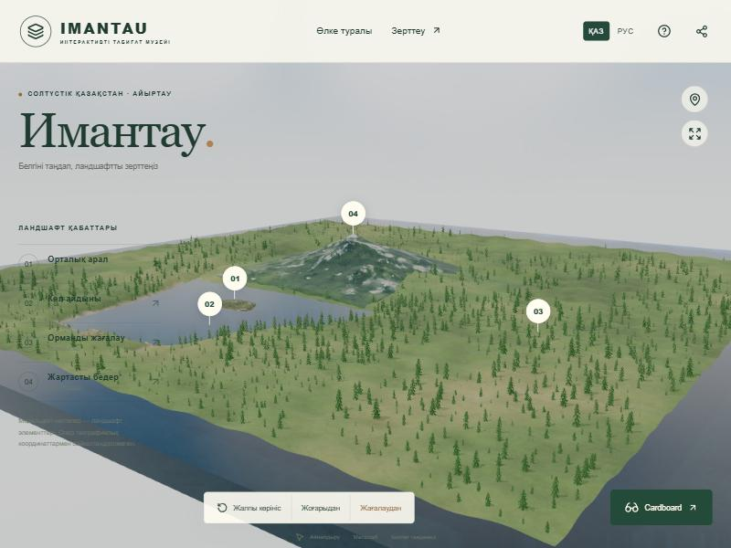
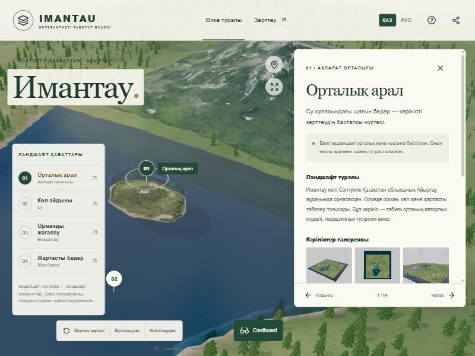

# IMANTAU — интерактивті табиғат музейі

Имантау көліне арналған интерактивті 3D сайт. Орталықта Blender-де жетілдірілген арал-көл моделі. Сайтта зерттеу нүктелері, ақпарат панельдері, қазақша/орысша интерфейс, Cardboard VR режимі және QR арқылы бөлісу бар.


| Жағалаудан | Орталық арал және ақпарат панелі |
|---|---|
|  |  |

## Іске қосу

Node.js 20.19+ (немесе 22.12+) және pnpm қажет.

```bash
pnpm install
pnpm dev
```

Production нұсқасы:

```bash
pnpm build
pnpm preview
```

Дайын статикалық сайт `dist/` қалтасында жиналады (`base: './'`, сондықтан GitHub Pages, Netlify, Vercel-ге жариялауға болады). QR-код жария мекенжайға жасалуы үшін build алдында URL көрсетіңіз:

```bash
VITE_PUBLIC_SITE_URL=https://сіздің-домен.kz pnpm build
```

Жергілікті мекенжайға (localhost, IP, http) QR жасалмайды — бұл әдейі жасалған тексеріс.

## Сайт мүмкіндіктері

- **3D көрініс** (Three.js): тінтуірмен айналдыру, дөңгелекпен масштаб, оң батырмамен жылжыту, қос шерту — нысанға фокус, пернетақта (бағыттар, `+`/`−`, `Home`, `Esc`).
- **Камера пресеттері:** «Жалпы көрініс», «Жоғарыдан», «Жағалаудан». Телефонда кадр арал толық көрінетіндей автоматты есептеледі.
- **4 зерттеу нүктесі** — модельдің нақты нысандарына бекітілген (рейкаст арқылы бетке қойылады): Орталық арал, Көл айдыны, Орманды жағалау, Жартасты бедер.
- **Ақпарат панелі:** сипаттама, ескертпе, модельден түсірілген көріністер галереясы, байланысты орындар, алдыңғы/келесі навигация. Таңдалған белгіден панельге дейін жалғаушы сызық тартылады.
- **Аннотациялар:** белгіні нұсқағанда қысқа түсініктеме шығады; тақырып жолағы мен панель астында қалған белгілер жасырылады.
- **Тіл:** қазақша (әдепкі) және орысша; барлық мәтін `src/data/content.ts` файлында, ауыстыру бетті қайта жүктемей бірден жүреді.
- **Cardboard VR:** стерео рендер (сол/оң көз), қозғалыс датчигіне рұқсат сұрау, «Осы бағытқа туралау», шығу батырмасы; датчик болмаса түсінікті хабарлама шығады.
- **Бөлісу:** QR-код (SVG жүктеу), сілтемені көшіру, жүйелік «Бөлісу».

## 3D модель қалай жасалды

Модельдің өңделу жолы үш кезеңнен тұрады. Түпнұсқа файлдар өзгертілмейді.

```
scene_pbr.usdz (түпнұсқа, 117 МБ)
   │  tools/restore_assets.py — USD-тен жоғалған текстуралар мен UV қалпына келтіру
   ▼
work/IMANTAU-restored.glb
   │  tools/blender_enhance.py — Blender: текстура, орман, тау, су
   ▼
public/scenes/IMANTAU-enhanced.glb (сайт осыны жүктейді, ~19,7 МБ, WebP)
```

### 1. Диагностика және қалпына келтіру (USDZ → GLB)

USDZ мен Blender арқылы алынған `IMANTAU.glb` салыстырылды (`work/diagnostics/assets.json`, `restoration.json`):

- Объект саны сәйкес: 1 582 меш USDZ-те де, GLB-де де.
- **Ақаудың себебі:** жағалау материалы («Moss Soil PBR») GLB-де текстурасыз қалған — USD-тегі `Procedural base color` пен `Procedural tangent normals` және олар қолданатын екінші UV (`UVMap_002`) экспорт кезінде жоғалған. Сондықтан жағалау ақ болып көрінген.
- `restore_assets.py` USD сахнасынан 32 761 төбенің UV координаттарын геометрия бойынша сәйкестендіріп, екі текстураны байт-байтымен GLB-ге қайтарды. Ось түрлендіруі: USD Z-жоғары → glTF Y-жоғары, `(x, y, z) → (x, z, −y)`.
- USD-тегі жарық тек біркелкі қара-сұр DomeLight (`color_121212.hdr`), сондықтан веб үшін жаңа жарық жасалды.

### 2. Blender-де жетілдіру (`tools/blender_enhance.py`)

Скрипт Blender 5.2-де фондық режимде жұмыс істейді (Cycles арқылы текстура «пісіріледі»):

```bash
blender -b --factory-startup --python tools/blender_enhance.py
```

| Не өзгерді | Қалай |
|---|---|
| **Жағалау шөбі** | Түпнұсқа текстура (30%) + әлемдік координаттағы шалғын дақтары (қою жасыл → жасыл → құрғақ сарғыш), орташа және ұсақ кедір-бұдыр. 4096×4096 текстураға пісірілді. |
| **Су жиегі** | Биіктікке қарай: су деңгейінің (z = −0,38) жанында ылғалды күңгірт жолақ, құмды жиек, су астында дымқыл топырақ. Жиек шуылмен табиғи иілген. |
| **Тау етегі** | Бұрын қою жасыл тікбұрыш болып ерекшеленіп тұрған. Енді сол әлемдік шейдермен боялып, жағалаумен жігсіз жалғасады. |
| **Тау** | Сканерленген текстура көкшіл-сұр еді. Қараңғы бөліктері (өсімдік) қарағай жасылына, ашық бөліктері (жартас) жылы сұрға боялды. |
| **Қарағайлар** | Ине жапырақ текстурасы ашық сарғыш-жасыл, бояу жоқ — ағаштар «қырау басқандай» ақшыл көрінген. Қою жасыл реңк (`baseColorFactor`) қосылып, жылтыры азайтылды. |
| **Орман тығыздығы** | 780 қарағайға тағы 1 941 дана қосылды (барлығы 2 721). Жаңа меш жоқ — бар қарағайлардың сілтемелі көшірмелері, бетке рейкастпен қойылады, шуыл маскасы алаңқайлар қалдырады, су жиегіне жақындамайды. Тұрақты seed — нәтиже қайталанады. |
| **Су** | Жұтылу түсі терең көк `#2a6fc0`, қашықтығы 0,6 (`KHR_materials_volume`). Түпнұсқада 0,5 қашықтық пен қою түс суды қап-қара етіп көрсеткен. |
| **Көлем** | Барлық суреттер WebP-ге (`EXT_texture_webp`) экспортталды: 28 МБ → 19,7 МБ. |

Геометрия, UV, нормальдар, түпнұсқа жартас пен арал текстуралары өзгертілген жоқ. Нәтиже есебі: `work/diagnostics/enhance.json`.

### 3. Сайттағы рендер (`src/viewer/`)

- **Аспан:** анықтамалық фотоға ұқсас көк аспан мен будақ бұлттар процедуралық түрде салынады; ол әрі фон, әрі PMREM ортасы — көлде бұлттар шағылысады.
- **Күн:** жылы бағытты жарық, жұмсақ көлеңке (PCF, қарқындылығы 0,72 — қара көлеңке жоқ), AgX tone mapping.
- **Су:** көлеңке түсірмейді (әйтпесе түбін қараңғылайды), орта шағылысы күшейтілген.
- **Өнімділік:** бірдей қарағайлар `InstancedMesh`-ке біріктіріледі — 33 draw call.

## Жоба құрылымы

```
src/
  App.tsx                 интерфейс, белгілер, жалғаушы сызық
  data/content.ts         қазақша/орысша мәтіндер, 4 зерттеу нүктесі
  components/             InfoPanel, Modal, ShareDialog (QR)
  utils/publicUrl.ts      QR үшін жария URL тексерісі
  viewer/SceneEngine.ts   сахна, камера, пресеттер, белгі проекциясы
  viewer/assets.ts        GLB жүктеу, су, ағаштарды instancing
  viewer/lighting.ts      аспан, күн, көлеңке
  viewer/Cardboard.ts     стерео VR, датчик
tools/
  restore_assets.py       USDZ → қалпына келтірілген GLB (Python + OpenUSD)
  blender_enhance.py      Blender жетілдіру → сайт моделі
  verify.mjs              тесттер: node tools/verify.mjs
  diagnose_assets.py, verify_assets.py   диагностика
public/scenes/IMANTAU-enhanced.glb   сайт моделі
IMANTAU.glb                          бастапқы GLB (өзгертілмеген)
work/IMANTAU-restored.glb            аралық модель (Blender кірісі)
work/diagnostics/                    диагностика есептері
docs/screenshots/                    скриншоттар
```

`scene_pbr.usdz` (117 МБ) GitHub-тың 100 МБ шегінен үлкен болғандықтан репозиторийге қосылмаған. Оны жоба қалтасының жанына қойсаңыз, `restore_assets.py` қайта іске қосылады.

## Тексеру

- `pnpm build` — қатесіз өтеді.
- `node tools/verify.mjs` — URL ережелері, KK/RU кілттерінің толықтығы, нүктелер байланысы, Cardboard датчик тармақтары мен стерео проекция.
- Браузерде компьютер (800×600) және телефон (375×812) өлшемінде тексерілді: модель жүктеледі, консольде қате жоқ, көлденең айналдыру жоқ.

## Шектеулер

- Cardboard режимі нақты VR көзілдірікте тексерілмеген; датчиктер HTTPS пен құрылғыға байланысты.
- Сахнада ~4 млн үшбұрыш (көлеңкемен бірге) — әлсіз телефондарда кадр жиілігі төмендеуі мүмкін.
- Модель — авторлық көрініс, геодезиялық түсірілім емес. Белгілердің нақты географиялық нысандармен сәйкестігі расталмаған; бұл сайтта көрсетілген.
- Галереяда модельден түсірілген көріністер; табиғи фотосуреттер мен тексерілген тарихи деректер кейін қосылады.

## Дереккөздер

- [Имантау–Шалқар](https://imantau-shalkar.kz/object?id=2&lang=ru)
- [Abai Instituty — Имантау көлі](https://oq.gov.kz/en/abai/imantau-koli)
