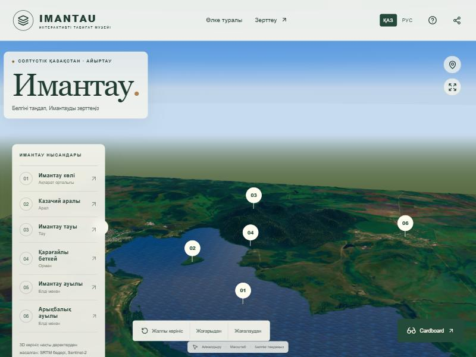
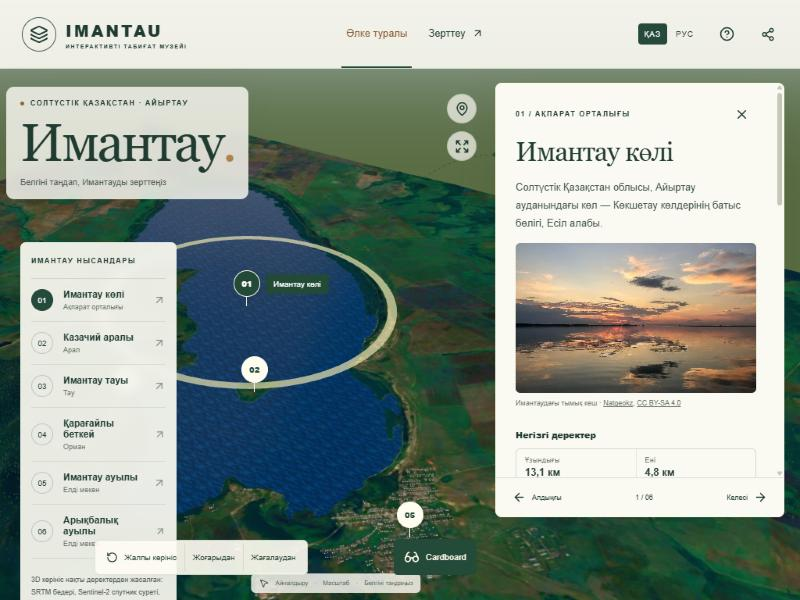

# IMANTAU — интерактивті табиғат музейі

Имантау көлі мен Имантау тауының **нақты** 3D моделі бар интерактивті сайт (Солтүстік Қазақстан облысы, Айыртау ауданы). Жер бедері — SRTM биіктік деректері, беті — Sentinel-2 спутник суреті, көлдің контуры, Казачий аралы және ауылдардағы үйлер — OpenStreetMap деректері. Сайтта Википедиядағы деректер, Wikimedia Commons-тағы Имантаудың нақты фотосуреттері, қазақша/орысша интерфейс, Cardboard VR және QR арқылы бөлісу бар.



| Имантау ауылы жағынан | Ақпарат орталығы (нақты фото, деректер) | Телефон |
|---|---|---|
|  |  |  |

## Іске қосу

Node.js 20.19+ (немесе 22.12+) және pnpm қажет.

```bash
pnpm install
pnpm dev
```

Production нұсқасы:

```bash
pnpm build
pnpm preview
```

Дайын сайт `dist/` қалтасында. QR-код жария мекенжайға жасалуы үшін build алдында URL көрсетіңіз (`VITE_PUBLIC_SITE_URL=https://сіздің-домен.kz pnpm build`). Cardboard датчиктері тек HTTPS арқылы жұмыс істейді.

## 3D модель нақты деректерден қалай жасалды

```
tools/geo_fetch.sh        ашық деректерді жүктеу (бедер, спутник, OSM)
        ↓
tools/geo_prepare.py      бедер, көл маскасы, текстура, ағаш орындары, үйлер, белгілер (Python + numpy + Pillow)
        ↓
tools/blender_build_imantau.py   Blender-де 3D сахна → public/scenes/IMANTAU-real.glb
```

```bash
bash tools/geo_fetch.sh
python tools/geo_prepare.py
blender -b --factory-startup --python tools/blender_build_imantau.py
```

**Аумақ:** шамамен 22 × 23 км (52.88–53.09° с.е., 68.12–68.44° ш.б.) — көл, Имантау тауы, Имантау және Арықбалық ауылдары.
**Масштаб:** 1 бірлік = 40 м; биіктіктер көріну үшін **2,5 есе** үлкейтілген; ағаштар мен үйлер де ірілендірілген. Бұл сайтта да жазылған.

1. **Жер бедері.** AWS Terrain Tiles (SRTM негізіндегі ашық деректер), z13, ~11 м пиксель. 3×3 тегістеу, 480×512 торлы меш (~46 м қадам).
2. **Көл.** OpenStreetMap-тағы «Имантау көлі» мультиполигоны: сыртқы контур — көл, ішкі сақина — Казачий аралы. Көл деңгейі SRTM бойынша 321 м (Википедияда 323 м). Түбі жағадан қашықтыққа қарай тереңдейді, ең көбі 10 м (Википедия: орташа 5,7 м, ең көбі ~10 м). SRTM-да арал көлмен бірдей тегіс болғандықтан, оған ~8 м биіктік қосылды.
3. **Беті.** Sentinel-2 cloudless 2016 (EOX, CC BY 4.0), z14 (~6 м пиксель), 4096×4096 текстура; түс қанықтығы мен контрасты сәл көтерілді.
4. **Орман.** Спутник суретіндегі қою жасыл (қарағай) аймақтарға берілген қарағай моделінің 7 000 көшірмесі қойылды — алдымен Имантау тауының сілемі (Википедия: беткейлері қарағай орманы), сосын көл жағалары. Ине жапырақтар Көкшетау қарағайының қою көкшіл-жасыл түсіне боялды.
5. **Ғимараттар.** OpenStreetMap-тағы 685 нақты ғимарат контуры көтеріліп салынды (биіктігі шартты).
6. **Су.** Берілген анимациялық су моделі (shape key толқындары) көл контурын жабатындай созылып, тынық көл толқынына дейін жалпайтылды; көк түске боялып, аздап мөлдір жасалды.
7. **Белгілер.** Нақты орындар: көл ортасы, Казачий аралы (OSM ішкі сақинасы), Имантау шыңы (52°56′45″, 68°17′16″ маңындағы ең биік нүкте), көлге қараған солтүстік-шығыс беткей, Имантау және Арықбалық ауылдары (OSM `place` нүктелері).

Сайтта аспан мен бұлттар процедуралық түрде салынып, көлде шағылысады; модельдің шеті алыстағы тұманға сіңеді.

## Сайттағы ақпарат пен фотосуреттер

Мәтіндер тек тексерілген деректерден алынды (дереккөздері әр карточкада):

- [Wikipedia — Imantau (lake)](https://en.wikipedia.org/wiki/Imantau_(lake)) (Қазақстан ұлттық энциклопедиясына сілтеме): ұзындығы 13,1 км, ені 4,8 км, ауданы 49 км², орташа терең. 5,7 м, ең терең ~10 м, 323 м биіктік, су жинау алабы 483 км², Иманбұрлық өзені ағып шығады, қазаннан мамырға дейін мұз, минералдануы 780–840 мг/л, балықтары.
- [Википедия — Имантау (гора)](https://ru.wikipedia.org/wiki/Имантау_(гора)): биіктігі 621 м, ұзындығы ~7 км, ені ~5 км, гнейс, кварцит, филлит, кристалды тақтатастар, беткейлері қарағай орманы.
- [Википедия — Имантау (озеро)](https://ru.wikipedia.org/wiki/Имантау_(озеро)).

Фотосуреттер — [Wikimedia Commons: Imantau (lake)](https://commons.wikimedia.org/wiki/Category:Imantau_(lake)) санатынан, авторлары мен лицензиясы әр суреттің астында көрсетілген: Natgeokz, Knajz (CC BY-SA 4.0), Sergoman (CC BY 3.0). Суреттер `public/photos/` ішінде, `tools/fetch_photos.mjs` арқылы жүктеледі.

## Cardboard VR

- **Толық экран және көлденең бағдар** «VR іске қосу» батырмасын басқан сәтте сұралады (бұрын датчикті күткеннен кейін сұралатын, сондықтан браузер бас тартатын). Android-та экран көлденең күйге бекітіледі; iPhone Safari элементтің толық экранын қолдамайды — онда «телефонды бұрыңыз» кеңесі шығады.
- **Көзқараспен жүру:** жерге (құрғақ бетке) қараңыз — көздеуіш шеңбері ~1,6 с ішінде толады да, сіз сол нүктеге жайлап көшесіз. Су мен аспан есептелмейді. Жер биіктігі арнайы биіктік торы бойынша есептеледі, сондықтан телефонды баяулатпайды.
- VR Имантау ауылы жағынан, Казачий аралына қарап басталады; «Туралау» және «VR шығу» батырмалары бар.

## Жоба құрылымы

```
src/
  App.tsx                 интерфейс, белгілер, VR басқару
  data/content.ts         қазақша/орысша мәтіндер, 6 нақты орын, фотосуреттер, дереккөздер
  components/InfoPanel.tsx  деректер кестесі, нақты фото, лайтбокс, дереккөздер
  viewer/SceneEngine.ts   сахна, камера ракурстары, белгілер, VR көзқараспен жүру
  viewer/heightfield.ts   VR үшін жеңіл биіктік торы
  viewer/assets.ts        GLB жүктеу, instancing, толқын анимациясы
  viewer/lighting.ts      аспан, күн, көлеңке, тұман
  viewer/Cardboard.ts     стерео рендер, датчик
tools/
  geo_fetch.sh, geo_prepare.py, blender_build_imantau.py   нақты 3D модель
  fetch_photos.mjs        Commons фотосуреттері
  verify.mjs              тесттер
  blender_build_scene.py, blender_enhance.py, restore_assets.py …  алдыңғы нұсқалар (тарих)
public/scenes/IMANTAU-real.glb   сайт моделі (~19 МБ)
public/photos/                   фотосуреттер
work/geo/bounds.json             аумақ шекаралары
```

Берілген бастапқы ассеттер (`pine-tree`, `water-animation`) лицензиясы белгісіз болғандықтан репозиторийге салынбаған; оларды `assets/source/` ішіне қойыңыз. Жүктелген гео-деректер де салынбаған — `tools/geo_fetch.sh` қайта жүктейді.

## Тексеру

- `pnpm build` — қатесіз өтеді.
- `node tools/verify.mjs` — URL ережелері, KK/RU кілттері, орындар байланысы, Cardboard датчик тармақтары, стерео проекция және VR көзқарас сәулесінің биіктік торымен қиылысуы.
- Браузерде компьютер және телефон (375×812) өлшемінде тексерілді: модель жүктеледі, 6 белгі де нақты орнында, биіктік торы дайын, көлденең айналдыру жоқ. Компьютерде ~4,8 млн, телефонда ~2,6 млн үшбұрыш.

## Шектеулер

- Cardboard режимі және көзқараспен жүру нақты телефон мен VR көзілдірікте тексерілмеген (тек синтетикалық тест және компьютер браузері).
- Спутник суреті 2016 жылғы, ~6 м/пиксель — жақыннан бұлыңғыр. Ағаштар саны нақты орманнан әлдеқайда аз, олар мен үйлердің өлшемі шартты.
- SRTM-да тау шыңы тегістеуден кейін ~606 м (ресми 621 м).
- Барлық деректер мен суреттер ашық лицензиямен: Sentinel-2 cloudless (CC BY 4.0, EOX), OpenStreetMap (ODbL), Commons суреттері (CC BY-SA 4.0 / CC BY 3.0) — атрибуция сайтта және осы файлда.
